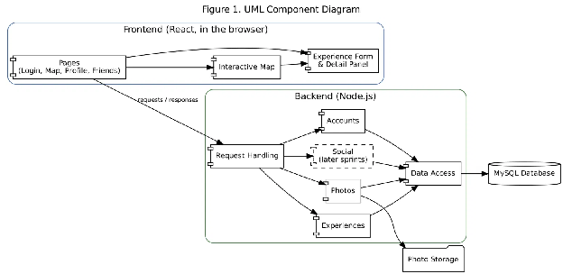
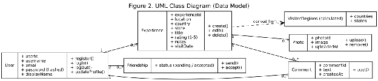
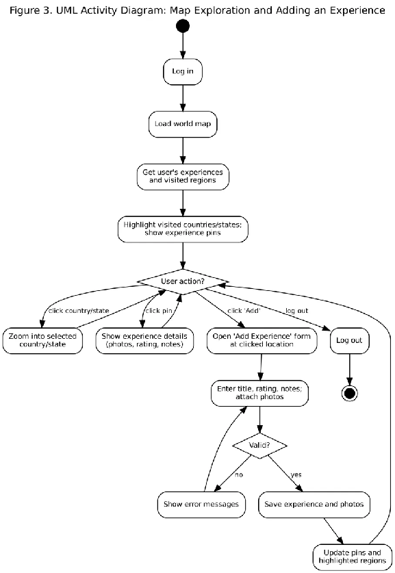

# **Project 3: Initial Architecture and Sprint 1 Requirements Artifacts**

EECS 581 Software Engineering II, Fall 2026  
**Team Number:** Team 4  
**Team Members:** Adam Darst, Arin Shah, Om Ghonasgi, Axel Bengoa, Jal Maru, Marcos Lepage  
**Project Name:** TripTrace  
**Project Synopsis:** A travel journal app where users pin trips on an interactive world map with photos, ratings and notes, and share them with friends.

## **Initial Architecture**

### **Overview**

TripTrace is a travel journal built around an interactive world map. Users create an account, log the places they have traveled, and see their travel history laid out on the map. Each trip is saved as an "experience": a pin on the map with photos, a star rating, and personal notes about what the user did there. Every country or state the user has visited is highlighted, so the map becomes a visual record of everywhere they have been. Clicking a country or state zooms the map into that region so the user can browse the experiences there. Later in the project, users will be able to add friends, view the trips their friends have shared, and comment on them, turning a personal travel log into a social one.

The app is a web application with three parts. A React frontend is what users see and interact with in their browser. A Node.js backend handles the app's logic. A MySQL database stores all user data. Keeping these parts separate lets team members work on the interface and the server at the same time, as long as they agree on how the two communicate.

### **Frontend**

The frontend includes these pages:

> * Login and registration pages  
> * The main map page  
> * A form for adding or editing an experience  
> * A panel showing an experience's details  
> * Profile and friends pages, in later sprints

>   
The map is the center of the app. When a user logs in, the frontend asks the backend for that user's experiences and visited regions. It then draws a pin for each experience and highlights the matching countries and states. Clicking a region zooms the map into it. Clicking a pin opens that experience's photos, rating and notes in a side panel. When a user adds a new experience, the map updates right away to show the new pin and any newly visited region.

### 

### **Backend**

The backend receives requests from the frontend, checks that they are allowed, applies the app's rules, and reads or writes data in the database. Its work falls into four areas, shown in 

Figure 1:

> * **Accounts:** creating accounts, logging users in and out, and making sure each request comes from a logged-in user.  
> * **Experiences:** creating, editing, deleting and listing a user's experiences. This includes checking that the data is valid (for example, that a rating is between 1 and 5\) and recording which country and state each experience is in.  
> * **Photos:** accepting photo uploads, checking file type and size, and storing them so they can be shown later.  
> * **Social features (later sprints):** friend requests, friend lists, and comments on friends' experiences.

>   
All database access goes through one shared layer, so the rest of the backend does not need to know how data is stored.

### **Data Model**

Figure 2 shows how the app's data is organized:

> * Each user can have many experiences.  
> * An experience holds its location, country, state, title, rating, notes and visit date.  
> * An experience can have many photos and, later, many comments.  
> * A friendship connects two users and records whether the request is pending or accepted.

The list of visited countries and states is not stored separately. It is calculated from the user's experiences, so the highlighted map always matches what the user has logged. Deleting an experience also removes its photos and comments.

### **How the Parts Work Together**

Figure 3 follows a typical session. The user logs in, the map loads with their pins and highlighted regions, and the app waits for input. From there the user can zoom into a region, open an existing experience, or add a new one. To add an experience, the user clicks a spot on the map, fills in a title, rating, notes and photos, and saves. The frontend checks that required fields are filled in, then sends the experience to the backend, which validates it and saves it to the database. The map then refreshes to show the new pin and highlight any newly visited country or state.

### **Security and Privacy**

The app stores personal photos and locations, so each user's data is private by default:

> * Passwords are stored in hashed form, never as plain text.  
> * Every request after login must prove the user is signed in.  
> * Users can only see and change their own experiences.  
> * Once friends are added, a user's experiences will be visible only to friends they have accepted.  
> * Sensitive settings such as database passwords are kept out of the project's code.

## **Sprint 1 Requirements Artifacts**

Sprint 1 includes requirements 1, 2, 3, 4, 5, 6, 10, 18, and 19, for a total of 44 story points across 6 team members. Each artifact below lists the acceptance criteria and the steps a GTA can follow to confirm the requirement is complete.

### **Requirement 1: Create an account and log in (8 points)**

**User story:** As a traveler, I want to create an account and log in so that my trips are saved to me.  
**Acceptance criteria:**

> * The Register page accepts a username, email, and password (minimum 8 characters) and rejects a duplicate username or email with a clear message.  
> * Passwords are stored as hashes; no plain-text password appears in the users table.  
> * Logging in with correct credentials opens the Map page; incorrect credentials show "Invalid username or password".  
> * Pages and data that require login cannot be reached without logging in.

### **Requirement 2: Explore the world map (8 points)**

**User story:** As a traveler, I want to pan and zoom around a world map so that I can find the places I have been.  
**Acceptance criteria:**

> * After logging in, a world map with country borders fills the main view.  
> * The user can pan by dragging and zoom with the scroll wheel and the on-screen \+/- buttons.  
> * U.S. state borders are drawn when the map is zoomed into the United States.  
> * The map loads in under 3 seconds on a standard connection.

### **Requirement 3: Place an experience as a marker (5 points)**

**User story:** As a traveler, I want to drop a marker where I took a trip so that it shows on my map.  
**Acceptance criteria:**

> * Clicking "Add Experience" and then a point on the map opens a form prefilled with that location, country and state.  
> * Saving the form with a title creates a marker at that point; a missing title shows a validation error.  
> * The marker remains after the page is refreshed.

### **Requirement 4: Attach pictures to an experience (5 points)**

**User story:** As a traveler, I want to attach photos to a trip so that I can remember it.  
**Acceptance criteria:**

> * The experience form accepts one or more JPEG or PNG files, up to 10 MB each.  
> * Other file types or oversized files are rejected with an error message.  
> * Uploaded photos are saved and shown as thumbnails on the experience.

### **Requirement 5: Rate an experience out of 5 stars (2 points)**

**User story:** As a traveler, I want to rate a trip so that I remember which ones I enjoyed most.  
**Acceptance criteria:**

> * The form shows a 5-star control; clicking a star sets the rating from 1 to 5\.  
> * Any rating outside 1 to 5 is rejected.  
> * The saved rating appears on the experience.

### **Requirement 6: Add personal notes to an experience (2 points)**

**User story:** As a traveler, I want to write notes about a trip so that I can record details.  
**Acceptance criteria:**

> * The form includes a notes field that accepts up to 2,000 characters, with a visible character count.  
> * Saved notes appear on the experience with line breaks preserved.

### **Requirement 10: Persistent storage of user data (8 points)**

**User story:** As a traveler, I want my trips saved so that they are still there next time I log in.  
**Acceptance criteria:**

> * The MySQL database includes users, experiences and photos tables linked as shown in Figure 2\.  
> * Experiences, photos, ratings and notes remain after logging out, restarting the server and logging back in.  
> * Each user sees only their own experiences.

### **Requirement 18: Highlight visited countries and states (3 points)**

**User story:** As a traveler, I want the countries and states I have visited to be shaded so that I can see my travel coverage.  
**Acceptance criteria:**

> * Any country or U.S. state containing at least one of the user's experiences is filled with the highlight color.  
> * Adding the first experience in a new country highlights it immediately, without a page refresh.  
> * Countries with no experiences keep the default color.

### **Requirement 19: Click a country or state to zoom in (3 points)**

**User story:** As a traveler, I want to click a country or state to zoom into it so that I can see my experiences there in detail.  
**Acceptance criteria:**

> * Clicking a country zooms and centers the map so the whole country fills the view.  
> * Clicking a U.S. state while zoomed into the United States zooms into that state.  
> * A "Back to world" button returns to the full world view.

